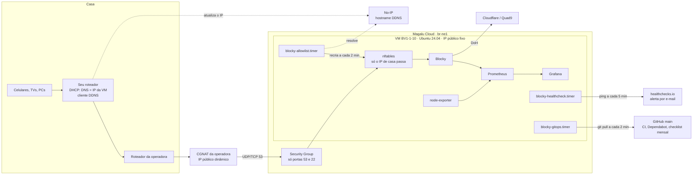

# blocky-cloud-dns

DNS com bloqueio de anúncios e rastreadores para a rede de casa, rodando
[Blocky](https://0xerr0r.github.io/blocky/latest/) numa VM mínima da Magalu Cloud.
Qualquer dispositivo que use o roteador como DNS passa a ter anúncios, rastreadores,
telemetria e domínios de malware bloqueados — sem instalar nada nos dispositivos.



## Como funciona

| Camada | Ferramenta | Como muda |
|---|---|---|
| Infra (VM, IP, firewall) | Terraform em `infra/`, state remoto no Object Storage da Magalu | `make plan` / `make apply` na sua máquina |
| Aplicação (Blocky, monitoramento) | Docker Compose em `deploy/` | **GitOps**: merge na `main` → a VM aplica sozinha em ~2 min |
| Qualidade | pre-commit local + GitHub Actions (`.github/workflows/ci.yml`) | cada commit passa por fmt, shellcheck e varredura de segredos (gitleaks); cada PR/push valida Terraform, config do Blocky e Prometheus |
| Atualizações | Dependabot + unattended-upgrades | PRs semanais de imagens; patches de SO automáticos (reboot 04:30 se preciso) |

### Decisões de projeto

- **Firewall por IP de origem, acompanhando o IP dinâmico.** O roteador mantém um hostname
  DDNS com o IP atual de casa. A cada 2 min a VM resolve esse hostname e recria uma tabela
  nftables (`scripts/allowlist.sh`) que só deixa esse IP (e os `extra_allowed_cidrs`)
  falar com o DNS (53) e o SSH (22). Quando a operadora troca o IP, a VM se ajusta sozinha
  em até ~2 min. O Security Group só restringe portas, e nunca entra IPv6. Assim o servidor
  não vira resolver público (amplificação de DNS) e a VM não precisa de nenhuma credencial
  da nuvem. A tabela falha fechada (sem origem conhecida, ninguém passa), mantém o último
  IP válido se o DDNS falhar e sobe antes do Docker no boot.
- **O IP público é um recurso separado da VM.** Se a VM for recriada (troca de imagem,
  mudança no cloud-init), o IP continua o mesmo, então o roteador não precisa ser
  reconfigurado.
- **GitOps pull em vez de push.** É a própria VM que busca o repositório. O CI não precisa
  de SSH nem de credenciais da nuvem, e nenhuma porta extra é aberta. O repositório pode
  ser público porque não contém segredos: o IP de casa, a API key e a senha do Grafana
  ficam fora dele.
- **Deploy seguro.** Cada commit novo é validado na VM (`docker compose config`,
  `blocky validate` e `promtool check config`) antes de ser aplicado. Depois de aplicar,
  o script testa se o DNS resolve e, se não resolver, **volta sozinho para o último commit
  que funcionava**. Um commit que falhou não é tentado de novo, só o próximo.
- **Upstreams DoH.** As consultas saem da VM criptografadas para Cloudflare e Quad9, então
  nem o provedor da nuvem nem o de internet enxergam o conteúdo.
- **Uso consciente de recursos.** É a menor VM disponível (1 vCPU, 1 GB de RAM e 10 GB de
  disco), com 1 GB de swap, limite de memória em cada container, rotação de logs e
  retenção de métricas limitada (30 dias ou 1 GB). O Blocky usa cerca de 75 MB de RAM com
  a lista de ~230 mil domínios.

## Estrutura

```
infra/                  Terraform: VM, IP público, security group, cloud-init
deploy/                 Tudo que roda na VM (fonte da verdade do GitOps)
  compose.yaml          blocky, prometheus, node-exporter, grafana
  blocky/config.yml     ← configuração do Blocky (o arquivo que você mais vai editar)
  prometheus/           scrape config
  grafana/              datasource e dashboards provisionados
  systemd/              timers do GitOps, do healthcheck e do allowlist
scripts/
  gitops-sync.sh        reconciliação na VM: validar → aplicar → verificar → rollback
  healthcheck.sh        testa resolução/bloqueio e pinga o healthchecks.io (opcional)
  allowlist.sh          libera só o IP de casa (via DDNS) em DNS e SSH
  bootstrap-state.sh    cria o bucket do state do Terraform (uma vez)
.github/
  workflows/ci.yml      gate do GitOps: Terraform, blocky validate, promtool, pre-commit
  workflows/monthly-checklist.yml  abre a issue de manutenção todo dia 1º
  monthly-checklist.md  conteúdo dessa issue
  dependabot.yml        PRs semanais de imagens, Terraform e Actions
Makefile                interface de operação (`make help`)
```

## Setup do zero

Pré-requisitos: `mgc` (logado), `terraform` ≥ 1.10 (ou `tofu`, usando `TF=tofu`),
`aws` CLI (só para o bootstrap do bucket), `git`, `dig` e uma chave SSH cadastrada na
Magalu Cloud (variável `ssh_key_name`, padrão `mgdn-key`).

```bash
# 1. Credenciais: crie uma API key com escopo mínimo (o comando está no .env.example)
cp .env.example .env    # preencha com api_key, key_pair_id e key_pair_secret

# 2. Bucket do state + terraform init + hooks do pre-commit
make bootstrap
make hooks              # requer `pip install pre-commit`

# 3. DDNS no roteador (veja "Configurar o DDNS" abaixo) e variáveis locais
cp infra/terraform.tfvars.example infra/terraform.tfvars   # home_ddns_host = "<seu hostname>"
make apply
```

O `apply` cria a VM. O cloud-init instala o Docker, clona este repositório e chama o
`gitops-sync.sh`, que sobe a stack. O Blocky começa a responder em 3 a 5 minutos. Para
testar:

```bash
make test
# resolve cloudflare.com -> 104.16.x.x
# bloqueia pagead2.googlesyndication.com -> 0.0.0.0
```

### Configurar o roteador

1. Pegue o IP com `terraform -chdir=infra output dns_ip`.
2. No roteador, em **DHCP / LAN**, coloque esse IP como **DNS primário** e deixe o
   secundário vazio. Se o roteador exigir um secundário, repita o mesmo IP.
3. Reconecte os dispositivos (ou espere o lease do DHCP renovar).

> Não use um DNS público (8.8.8.8 etc.) como secundário: os dispositivos alternam entre
> os servidores e os anúncios voltam a aparecer. A contrapartida é que, se a VM cair, a
> internet de casa fica "sem DNS". Por isso existe o healthcheck com alerta (veja abaixo).

### Configurar o DDNS

A VM só aceita o IP que o hostname DDNS devolve, então ele precisa estar sempre certo.

1. No [No-IP](https://www.noip.com) (gratuito), crie um hostname **difícil de adivinhar**,
   com **Habilitar DNS dinâmico** marcado e **Wildcard** desmarcado.
2. Crie uma **Chave DDNS** para esse hostname. É uma credencial que só serve para
   atualizar o IP, então a senha da conta não fica gravada no roteador.
3. No roteador, em **DNS Dinâmico**: provedor **NO-IP**, usuário e senha da **Chave DDNS**
   e domínio **`all.ddnskey.com`**. Clique em *Efetuar login* e depois em *Salvar*.
4. **Valide antes de usar:** no painel do No-IP, mude o IP do hostname para `1.2.3.4`,
   clique em *Efetuar login* no roteador de novo e confira se o hostname voltou para o
   seu IP público:
   ```bash
   dig +short <hostname> @1.1.1.1
   curl -s https://1.1.1.1/cdn-cgi/trace | grep ip=
   ```
5. Coloque o hostname em `home_ddns_host` no `terraform.tfvars` e rode `make apply`.

Pontos que valem para este setup (dois roteadores e CGNAT):

- **Configure o DDNS no roteador que você controla.** Roteadores de operadora costumam
  bloquear alterações. O TP-Link da Brisanet, por exemplo, devolve o erro 4508. Aqui o
  DDNS ficou no Mercusys AC12G, que fica atrás do roteador da operadora.
- **CGNAT:** se a WAN do roteador da operadora está em `100.64.0.0/10`, o IP público não
  aparece em nenhum roteador. Mesmo assim funciona, porque o No-IP registra o IP de origem
  da atualização. O teste do `1.2.3.4` é o que comprova. Se o roteador publicar um IP
  privado, `allowlist.sh` descarta o valor e mantém o último IP válido.
- **Deixe "DNS manual" desmarcado na WAN do seu roteador.** O cliente DDNS dele resolve
  nomes pelo DNS da operadora, não pelo Blocky. Por isso a atualização funciona justamente
  quando a casa perdeu o acesso ao Blocky.
- **No-IP gratuito:** confirme o hostname a cada 30 dias. O checklist mensal lembra.

## Operação do dia a dia

```
make help
```

| Comando | O que faz |
|---|---|
| `make status` | commit aplicado, containers, timers, RAM e disco |
| `make test` | testa resolução e bloqueio a partir da sua máquina |
| `make querylog N=100` | últimos domínios bloqueados (para descobrir o que quebrou algum app) |
| `make logs [SERVICE=grafana]` | logs dos containers |
| `make sync` | força o GitOps sync agora, sem esperar o timer |
| `make tunnel` | Grafana em `:3000`, Prometheus em `:9090`, API do Blocky em `:4000` |
| `make grafana-password` | senha do admin do Grafana |
| `make ssh` | shell na VM |
| `make allowlist` | IP de casa liberado agora e as últimas trocas detectadas |
| `make lint` | pre-commit em todos os arquivos + `terraform validate` |

### Mudar a configuração do Blocky

Edite `deploy/blocky/config.yml` e faça o merge na `main`. A referência completa está em
<https://0xerr0r.github.io/blocky/latest/configuration/>.

```bash
git switch -c libera-site
$EDITOR deploy/blocky/config.yml     # ex.: adicionar em allowlists → *.site-que-quebrou.com
git commit -am "blocky: libera site-que-quebrou.com" && git push -u origin libera-site
# abra o PR → CI valida → merge → em ~2 min está no ar (ou `make sync`)
```

Exemplos comuns:

- **Liberar um domínio:** adicione `*.dominio.com` no bloco inline de `allowlists.ads`.
- **Bloquear um domínio:** adicione no bloco inline de `denylists.ads`.
- **Adicionar uma lista:** acrescente a URL em `denylists.ads`. Prefira o formato wildcard
  (`*.dominio`), porque no Blocky uma entrada simples `dominio` não cobre subdomínios.
- **Nomes locais** (`nas.casa` → `192.168.0.10`): use `customDNS.mapping`.
- **Pausar o bloqueio:** use os botões do dashboard do Grafana ou
  `curl localhost:4000/api/blocking/disable?duration=5m` com o `make tunnel` ativo.

Não há mudança manual na VM: o que não estiver na `main` é sobrescrito no próximo sync.

### IP de casa mudou

Nada a fazer: o roteador atualiza o DDNS e a VM libera o IP novo em até ~2 min
(`make allowlist` mostra o IP atual e o histórico de trocas).

Se o DNS de casa parar mesmo assim, o DDNS do roteador provavelmente parou de atualizar.
Confira com `dig +short <home_ddns_host> @1.1.1.1` contra o seu IP
(`curl https://1.1.1.1/cdn-cgi/trace`). Corrija o DDNS no roteador e espere 2 min.

**Break-glass** (DDNS fora e você sem SSH): coloque o IP atual em `extra_allowed_cidrs`
no `terraform.tfvars` e rode `make apply`. Isso recria a VM (mesmo IP público, ~5 min de DNS
fora), e ela sobe já liberando esse IP.

## Monitoramento

- **Grafana** (`make tunnel` e depois <http://localhost:3000>, usuário `admin`) tem dois
  dashboards provisionados:
  - **Blocky** (dashboard oficial do projeto): consultas por segundo, % bloqueado,
    cache hit, latência dos upstreams, tamanho das listas e botões para ligar ou desligar
    o bloqueio.
  - **Node Exporter Full**: CPU, RAM, swap, disco e rede da VM.
- **Prometheus** coleta métricas a cada 30 s e guarda 30 dias (limitado a 1 GB).
- **Checklist mensal:** todo dia 1º o workflow `monthly-checklist` abre uma issue atribuída
  a você com as verificações do mês (confirmar o hostname no No-IP, conferir o allowlist,
  o healthcheck, os PRs do Dependabot e os prazos). Para abrir uma fora de hora:
  *Actions → monthly-checklist → Run workflow*.
- **Alerta externo (recomendado):** a VM não tem como avisar que ela mesma caiu. Crie um
  check gratuito em <https://healthchecks.io> (período de 5 min, tolerância de 10 min),
  coloque a URL em `healthcheck_url` no `terraform.tfvars` e rode `make apply`. A cada
  5 min o `healthcheck.sh` testa se o Blocky **resolve e bloqueia** e se **chegou alguma
  consulta da rede de casa nos últimos 30 min** (silêncio = casa sem acesso, ex.: DDNS
  desatualizado). Se algo falhar, ou se a VM sumir, o healthchecks.io envia e-mail,
  Telegram etc.

> Mudar `healthcheck_url`, `home_ddns_host` ou `extra_allowed_cidrs` altera o cloud-init,
> então **a VM é recriada**. O IP público
> continua o mesmo e o DNS fica fora por uns 5 minutos.

## Segurança e limitações

- **IPv6:** se o roteador também entrega um DNS IPv6 (do provedor) aos dispositivos, parte
  das consultas não passa pelo Blocky. Desative o DNS IPv6 via RA/DHCPv6 no roteador ou
  aponte-o para o mesmo resolvedor.
- **DoH nos navegadores:** Chrome e Firefox podem usar DNS-over-HTTPS próprio e ignorar o
  DNS da rede, e a HaGeZi PRO não bloqueia isso. Desative "DNS seguro" nos navegadores ou,
  para forçar em toda a rede, adicione a lista
  [HaGeZi DoH/VPN/Proxy Bypass](https://github.com/hagezi/dns-blocklists#bypass) em
  `denylists`.
- **CGNAT:** se o provedor usa CGNAT, o IP público de casa é compartilhado com outros
  clientes, que também conseguiriam usar o DNS. O risco é baixo (é só um resolver
  filtrado, sem dados sensíveis), mas vale saber.
- **Credenciais:** a API key usada pelo Terraform tem escopo mínimo (VM, rede e object
  storage) e expira em 1 ano. Renove antes do vencimento com o comando do `.env.example`.
- **SSH:** só por chave e só a partir do IP de casa (mesmo allowlist do DNS).
- **DDNS:** quem controla o hostname controla quem pode usar o DNS. Use uma conta DDNS com
  senha forte e não publique o hostname (ele fica só no `terraform.tfvars`).

## Custos

Tudo roda em uma BV1-1-10, um IPv4 público e um bucket com alguns KB de state. Consulte os
preços atuais em <https://magalu.cloud/precos>. `make destroy` remove a VM, o IP e o
firewall. O bucket de state continua existindo e pode ser apagado manualmente.

## Próximos passos

- [ ] **Samsung TV:** confirmar que ela usa o Blocky (renovar o DHCP) e bloquear a telemetria da TV (`*.samsungads.com`, `*.samsungacr.com`) se a lista não cobrir.
- [x] **IP dinâmico automático:** DDNS no roteador + allowlist no host (`scripts/allowlist.sh`).
- [ ] **Healthcheck sem recriar a VM:** tirar o `healthcheck_url` do cloud-init, para que trocar a URL não exija recriar a VM.
- [ ] **Alertar falha de GitOps:** o `gitops-sync.sh` ping `/fail` no healthchecks.io quando a validação falhar ou houver rollback.
- [ ] **CI:** fixar `runs-on: ubuntu-24.04` (o `ubuntu-latest` migra para o Ubuntu 26 em 19/10/2026).
- [ ] **Bloqueio fora de casa:** expor DoT/DoH (porta 853/443 com TLS e domínio próprio) para usar o Blocky no 4G como "DNS privado" do celular. Exige autenticação ou allowlist, para não virar resolver público.
- [ ] **Renovar a API key** `blocky-terraform` antes de **28/09/2027** (comando no `.env.example`).
- [ ] **Escala:** se a RAM disponível ficar abaixo de ~100 MB de forma consistente (`make status`), migrar para a `BV1-2-10`.

## Troubleshooting

| Sintoma | Verifique |
|---|---|
| Nada resolve em casa | `make allowlist` (o DDNS acompanha o IP atual?) e depois `make status` |
| `make ssh` diz *host key changed* | a VM foi recriada: `ssh-keygen -R $(terraform -chdir=infra output -raw dns_ip)` |
| Commit não foi aplicado | `make ssh` e `journalctl -u blocky-gitops -n 50` (validação falhou? houve rollback?) |
| Algum app/site quebrou | `make querylog` e depois liberar o domínio no `allowlists` |
| Primeiro boot demorando | `make ssh` e `sudo tail -f /var/log/cloud-init-output.log` |
| Repo estava inacessível no boot (privado/inexistente) | `make vm-bootstrap` |
